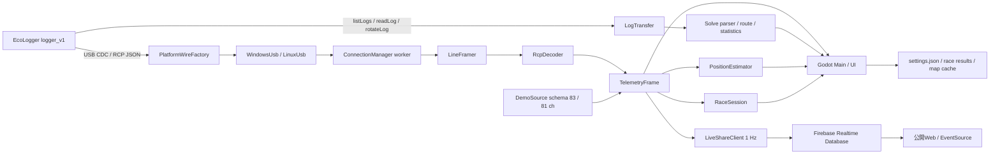

# RaceCapture / EcoCapture 統合引継ぎ（2026-09-02）

> **2026-09-04追記**：UX250h/MZAH10向けの未書込み試験版を作成しました。最新は `HANDOFF_20260904_UX250H.md` と `EcoCapture/UX250H_TEST.md` を優先してください。本書のlisten-only固定・schema83/81は旧版の履歴です。

この文書を、この作業環境の**最初の再開入口**とする。
既存の `ARCHITECTURE.md`、`firmware/logger_v1/HANDOFF.md`、各種検証文書は履歴を追記しているため、
古い節にも「現在」「最新」という表現が残っている。現行状態は本書の日付・ビルド名・ハッシュを優先する。

## 1. 現在の到達点

- EcoLogger実装基板用ファームウェアは `firmware/logger_v1` に統合済みで、実機へ書込み済み。
- 現在の実機ファーム表示は `logger-v1-ecocapture-20260902a`。
- SDはPC非接続でも100 Hz CSV記録を行い、未挿入起動後の後挿しで再起動せず記録を開始する。
- LOG LEDは記録中に点灯することを使用者が目視確認済み。
- SYS LEDは500 ms点滅を廃止し、起動中は常時点灯する実装へ変更・書込み済み。最終的な光学確認は使用者目視で行う。
- EcoCapture 0.3.5はWindows x64とLinux ARM64の配布物を生成済み。
- EcoCaptureの実USB-OTGとデモは、schema revision 83・81チャンネルの同一データ契約を通る。
- デモ中のライブ共有データがWebへ届かなかった不具合を修正し、Firebase Hostingへ公開済み。
- 公開Webは <https://ecocapture-live.web.app>。実USB相当点からデモ点へライブ更新する実ブラウザ試験に合格。
- ROCK 5B / Raspberry Pi 4向けARM64版は生成済みだが、対象機そのものではまだ起動・長時間試験をしていない。

## 2. 対象と接続

作業ルート:

```text
C:\Users\lintaroh\Documents\RaceCapture
```

主要対象:

- 本番ロガーソース: `firmware/logger_v1/`
- 実装基板: ESP32-S3-WROOM-1-N16R8、BNO055、MAX-M10M-00B、ATA6561、MCP25625
- Windows / Linux表示アプリ: `EcoCapture/`
- 表示側対象: Windows x64、将来のROCK 5B / Raspberry Pi 4 Linux ARM64
- ライブ共有: `EcoCapture/cloud/`、Firebase Realtime Database / Hosting

この実機で観測したポート:

- A105書込み・診断UART: `USB-Enhanced-SERIAL CH9102 (COM8)`
- ロガーのネイティブUSB CDC/OTG: VID/PID `303A/4001`、`COM10`

COM番号は再列挙で変わり得る。VID/PIDとデバイス名も確認し、COM番号だけを決め打ちしない。

## 3. 絶対に守る境界

- GNSS高性能クロックOTPはこの個体へ一度だけ設定済み。`provision_gnss25.py`を再実行しない。
- 通常ファームはOTPを読み取るだけで、再書込みしない。
- SDの自動フォーマット、満杯時の既存ログ削除、通常起動時の全消去は禁止。
- SDを抜く前は `firmware/logger_v1/tools/sd_control.py eject` で同期・クローズを確認する。
- 車載CANは通常listen-only。`testCanLoop`や`--desk-can-loop`はCAN1/CAN2を物理ループした卓上専用で、車両接続中は実行禁止。
- 旧DevKit/旧IMU用 `firmware/src/main.cpp` と診断用 `v1_test/` を、本番 `firmware/logger_v1` の代わりとして変更しない。
- 位置情報、SD原本、Flashバックアップ、地図タイル、実機画面、解析ZIPはGitへ入れない。
- 回路・PCB・3Dモデルの既存ローカル変更は、今回のアプリ/ファーム更新へ混ぜない。

## 4. logger_v1で完了した作業

### 4.1 本番ファーム統合

`firmware/logger_v1` に以下を統合した。

- BNO055 I2C（GPIO17/18、100 Hz、アドレス0x28、融合状態監視・内部異常復旧）
- MAX-M10M GNSS（UART 460800、起動時設定読戻し、RF/時刻/更新監視）
- SDMMCによる全チャンネル100 Hz CSVと生CAN別CSV
- ATA6561/TWAI/J5の車載CAN 500 kbps、既定listen-only
- MCP25625/J4のセンサーハブCAN 500 kbps
- USB CDCとA105 UARTのRCP互換応答、疎配列テレメトリ、最大10 HzのPC向け定期配信
- 設定・IMU水平補正・ラップ基準の専用NVS保存
- 制限付きLua、状態LED、診断コマンド

GNSS高性能クロックOTPはメーカー資料と実機ROMを照合して一度だけ設定した。
現在の測位周期は不可逆OTPそのものではなく、起動時RAM設定でGPS + Galileo + BeiDou B1C + GLONASSの10 Hzを使用する。
IMUとSDの100 Hzは維持している。

### 4.2 SDの運用と耐障害確認

確認済み:

- SD未挿入で起動しても本体、GPS、IMU、USBは動作を継続。
- SDマウントを約3秒周期で再試行し、ログに `will retry; NEVER format` を出す。
- 電源とENを触らずSDを後挿しすると、次の再試行で新しいCSVを作成して記録開始。
- 後挿し時にuptimeは継続し、再起動していない。
- 既存ログの自動削除・自動フォーマットは行わない。
- LOG LEDは `logging.status=1`・行数増加中に点灯することを使用者が確認。
- EcoCapture配布EXE試験中もSD記録は継続し、試験区間で4,911行増加、追加のSDエラー/欠落なし。

未完了:

- SDを物理的に満杯にした試験
- 記録中の物理抜去と再挿入を繰り返す耐久試験
- 電源瞬断時の最大損失評価
- 長時間・高温・高振動環境での継続記録

### 4.3 LED

物理順と意味は `SYS / ERR / LOG / GPS / TLM / WIFI / BT / CAN`。

- LOG: 記録中のみ点灯。実機目視済み。
- SYS: 以前の500 ms点滅を廃止し、sampling task動作中は常時点灯へ変更。
- ERR、LOG、GPS、TLM、CANの条件はSYS変更時に変更していない。

現行ソース:

- `firmware/logger_v1/src/main.cpp`
- `firmware/logger_v1/src/log_format.h`

現行イメージ（ローカル、Git除外）:

```text
firmware/logger_v1/artifacts/release_20260902_sys_solid/firmware.bin
615,056 bytes
SHA-256 2252311e266c0f97b74a72b3675d4a7ca9314939ae7d8f3176a09132554dea4d
```

A105 COM8からbootloader、partition、applicationを書込み、各領域のFlashハッシュ照合に成功。
再起動後に `git_info=logger-v1-ecocapture-20260902a` を読戻した。
32秒時点でSD 3,233行、SDエラー/欠落0、IMU正常、車載CAN listen-onlyを確認した。

### 4.4 ファームの検証

- PlatformIO / ESP-IDF 6.0.1実機ビルド成功。
- C++17、ASan/UBSan付きホスト試験4本に合格。
- 書込み前にSD 79,215行を同期・正常クローズし、書込み後に自動記録再開。
- GNSSの起動直後に累積エラー1が記録されたが、その後増加せず、3D測位・UTC有効・約10 Hzで安定。
- IMU内部エラー0、CAN送受信0、USB欠落0を確認。

詳細は次を参照:

- `firmware/logger_v1/VERIFICATION.md`
- `firmware/logger_v1/README.md`
- `firmware/logger_v1/IMU_RECOVERY.md`
- `firmware/logger_v1/GNSS_CHECK_20260901.md`
- `firmware/logger_v1/MULTIGNSS_10HZ.md`
- `firmware/logger_v1/SD_LOGGING.md`

## 5. EcoCaptureで完了した作業

### 5.1 アプリ構成

- Godot 4.7.2 .NET / .NET 8。
- Windows x64版とLinux ARM64自己完結版を同じC#ソースから生成。
- ロガーUSBはVID/PIDで探索し、A105の書込みポートを誤って開かない。
- 実機テレメトリ、Indicate、センサ状態、Race、Maps、Solve、設定、水平補正、デモを実装。
- 表示は最大10 Hz。受信履歴を無制限にRAMへ溜めず、SD記録はロガーへ任せる。

### 5.2 デモとUSB-OTGの同等化

修正前のデモはschema 1で、現行USBメタデータに対して28チャンネル不足していた。
修正後は以下を保証する。

- schema revision 83
- USBメタデータと同じ81チャンネル名
- 欠けていた加速度、重力、ラップ/時刻、AFR、CAN GPIO、Lua、GNSS UTC/RF/精度診断を追加
- デモとUSBが同じ `TelemetryFrame` 以降の保存・画面・ライブ共有経路を通る
- 実USBメタデータ集合とデモ値集合の完全一致を自動試験

実USBベンチは95/95サンプル正常、schemaとチャンネル集合一致。
配布EXEの実機UI試験でも実機→デモ→実機へ往復し、同等性を確認した。

### 5.3 ライブ共有不具合

原因は2点あった。

1. 送信側がデモフレームを設定条件で除外しており、共有キューへ入らなかった。
2. Web側が車体名/DEMO属性を共有メタだけに依存し、ページを開く時期や履歴混在で古い属性を表示し得た。

修正内容:

- デモも1 Hz共有キューへ入れる。
- latest/historyの各点へ `vehicle` と `demo` を自己記述させる。
- Webは点内属性を優先し、古いメタは後方互換フォールバックとしてだけ使う。
- 実測点とデモ点がキューで混在しても属性を保持する。

検証:

- .NETコア86項目合格
- Web 4項目合格
- 配布EXE実機UI 39項目、画面画像24枚、全項目合格
- USBだけを一度切断し、約2秒で自動復帰
- 実Firebaseへ匿名PATCH 204、読出し成功
- 公開Webを開いたままUSB相当点からデモ点へ更新し、`DEMO · デモ検証` 表示を確認
- 古い共有メタを故意に逆にしても点内属性を優先
- 一時検証チャンネルのlatest/meta/historyを削除し、すべてnullを確認

公開先:

```text
https://ecocapture-live.web.app
```

共有リンクを知る人が閲覧する方式で、利用者アカウント認証は実装していない。
共有URL IDは十分長い乱数だが、リンクを知る人には共有し直せるため、内輪だけで扱う。

Google AI Plus / Google Oneの契約はFirebase枠を増やさない。
FirebaseはSpark / BlazeとGoogle Cloud Billingで別管理する。

### 5.4 配布物

ローカル配布物（Git除外）:

```text
EcoCapture/dist/EcoCapture/EcoCapture.exe
  SHA-256 56bcc5bd6b4414ba840891a9fd1530ad009fce77507a4e953550ca3119a86ee0

EcoCapture/dist/EcoCapture-0.3.5-windows-x64.zip
  SHA-256 e5d9d7b4da0a2af0387f94ab990121b55035aeb0d9c29dda6b44ae45cde5652d

EcoCapture/dist/EcoCapture-linux-arm64/EcoCapture.arm64
  SHA-256 18199f9c8115aae98c6485bdf8120ba5315aded8bbcf0d860f2b431b2fa2126c

EcoCapture/dist/EcoCapture-0.3.5-linux-arm64.zip
  SHA-256 b2a6c11cbbdc723180b9789562a3f14e268701ccd0e60c4d68274b0e7d48fb2f
```

Linux ARM64はビルド・ELF形式・同梱.NETの監査まで。ROCK 5B / Raspberry Pi 4上の起動確認ではない。

詳細:

- `EcoCapture/README.md`
- `EcoCapture/BUILD.md`
- `EcoCapture/LINUX.md`
- `EcoCapture/SYSTEM_REQUIREMENTS.md`
- `EcoCapture/VERIFICATION.md`

### 5.5 EcoCaptureの設計図

実機とデモを入口だけで分け、`TelemetryFrame`以降は同じ処理へ流す。



層ごとの責務:

| 層 | 主なファイル | 責務 |
|---|---|---|
| RCPデータ契約 | `Core/Telemetry.cs` | 64 KiB上限の行分割、メタデータ、疎配列bitmap、schema、欠測の表現 |
| 実機接続 | `Transport/ConnectionManager.cs` | 接続・識別・10 Hz配信設定・コマンド多重化・停止検知・再接続 |
| OS依存USB | `Transport/WindowsUsb.cs` / `LinuxUsb.cs` | VID/PID限定列挙、Win32またはtermios/pollによる期限付きI/O |
| デモ | `Core/DemoSource.cs` | 実機と同じschema/チャンネルを持つ有限値の合成フレーム |
| 設定・車種 | `Core/Settings.cs` | 車種、表示項目、単位、範囲、保存形式、設定移行 |
| 位置・ラップ | `Core/Navigation.cs` | 地理計算、最大3秒のIMU補完、スタートライン交差、ラップ状態 |
| SD取得・解析 | `Core/LogTransfer.cs` / `Solve.cs` | ログ一覧、分割転送、`.part`保護、CSV解析、経路・統計 |
| ライブ共有 | `Core/LiveShare.cs` | 1 Hz間引き、送信待ち上限、点内属性、日別履歴、失敗時再送 |
| UI | `UI/Main.cs`ほか | Home / Indicate / Race / Maps / Solve / Settings、画面更新、保存 |
| Web閲覧 | `cloud/public/` | 直近30分履歴、EventSource、経路描画、点内のUSB/DEMO属性表示 |
| 試験・配布 | `tests/` / `tools/` | コア回帰、実機UI、USB復帰、性能、Windows/Linux export、監査 |

実行時のスレッド境界:

- Godotメインスレッド: UI生成、画面更新、入力、描画。
- `ConnectionManager`: USBハンドルを一つのバックグラウンドworkerだけが所有。
- UIへの受渡し: 最新の `TelemetryFrame` をatomicに差し替え、無制限の受信履歴を持たない。
- コマンド: workerのキューへ入れ、テレメトリと同じUSB接続上で応答名を照合する。
- `LiveShareClient`: UI/SDから独立した送信ループ。HTTP失敗で表示やロガー記録を止めない。
- 地図: Maps表示時だけ限定並列で取得し、ディスクキャッシュを次回起動時に整理する。

重要なデータ契約:

- チャンネル欠測は辞書からキーを**消す**。前回値を保持して正常値のように見せない。
- `TelemetryFrame.Fresh()`は1.25秒。古い値は画面上で無効扱いにする。
- schemaが変わる場合、ロガーは必ず新しいmetaを同じサンプルで送る。metaなしのschema変更はアプリが拒否する。
- 疎配列は「有効値列 + `ceil(channel_count/32)`個のbitmap」。値数とpopcountが違うフレームは破棄する。
- `monotonic_us`が進まないキャッシュ済みフレームは接続復帰とみなさない。
- デモは別の簡略フォーマットを作らず、実機と同じ `TelemetryFrame` を生成する。

### 5.6 EcoCaptureの開発環境

必須:

- Windows 10/11 x64またはglibc系Linux x86_64の開発環境
- Godot 4.7.2 .NETと同版のMono/.NET export templates
- .NET SDK 8（この環境では8.0.424）
- Windows/Linux ARM64配布に必要な.NET 8ランタイム取得環境
- Python 3 + Pillow + pyserial（実機UI試験・画像確認・A105診断）
- Node.js + pnpm（`EcoCapture/cloud/tests`）
- Firebase CLI（Hosting配備時のみ。通常ビルドには不要）

プロジェクト:

```text
EcoCapture/EcoCapture.csproj  Godot.NET.Sdk/4.7.2、net8.0
EcoCapture/project.godot      GL Compatibility、1280x800、30 fps上限
EcoCapture/Main.tscn          Mainノードだけを置く最小シーン
EcoCapture/export_presets.cfg Windows x64 / Linux ARM64 export
```

外部シリアルライブラリへ依存せず、WindowsはWin32 API、Linuxはglibcのtermios/pollをP/Invokeする。
Windows専用レジストリ/DLLをLinux経路から呼ばない。
日本語フォントはNoto Sans JPを同梱し、移植先OSのフォントへ依存しない。

通常の検証順:

```text
1. dotnet run --project tests/EcoCapture.Tests.csproj
2. dotnet build EcoCapture.csproj
3. Nodeで cloud/tests/web.test.mjs
4. tools/build.ps1 でWindows配布
5. tools/build.ps1 -LinuxArm64 でARM64配布
6. tools/audit_package.py でPE/ELF、同梱runtime、ZIP内容、SHA-256を監査
7. 実機接続時だけ tools/verify_app_ui.py と verify_usb_reconnect.py
```

試験用起動引数:

- `-- --demo`: USBを開かずデモ起動
- `-- --data-dir <path>`: 設定・結果・地図キャッシュを別フォルダーへ分離
- `-- --smoke-dir <path>`: 配布EXEの非実機スモーク試験
- `-- --hardware-test-dir <path>`: 実機UI試験。ユーザー設定を汚さない
- `-- --screen <name>`: 初期画面指定

実機UI試験は画面操作、設定保存、Solve、地図、デモ往復、USB復帰を自動化する。
試験中の設定は専用profileへ分離し、ユーザーの通常設定へ書かない。

### 5.7 EcoCaptureを拡張するときに知っておくこと

#### 新しいテレメトリチャンネル

1. logger_v1のmetadataへチャンネル名・単位・範囲・精度・更新頻度を追加する。
2. schema revisionを更新し、meta付きサンプルを必ず送る。
3. `DemoSource.LoggerChannels`とデモ値にも同名を追加し、実機/デモ集合一致を維持する。
4. 画面に出す場合は `Catalog.Sensors`または`Diagnostics`へ追加する。
5. Web共有が必要なチャンネルだけ `LiveShareClient.Channels`へ追加する。個人情報や不要な100 Hz値を無差別に共有しない。
6. `tests/Program.cs`のschema、疎配列、デモ、共有試験を更新する。

チャンネル名はプロトコル・CSV・設定JSON・Webの互換キーである。表示ラベル変更と同じ感覚で改名しない。
名称変更が必要なら、読取り側で旧名を一定期間フォールバックする。

#### 新しい車種/CAN項目

- 車種の表示名と初期表示項目は `Core/Settings.cs` の `Catalog.Vehicles`。
- 実CAN ID、bit位置、符号、係数はlogger_v1側のマッピング責務。
- 年式・型式が未確定なら仮値を既定化しない。
- 電気的接続、生フレーム受信、信号デコード、EcoCapture表示を別々に検証する。
- 車載CANはlisten-onlyを維持し、表示アプリ追加を理由に送信を有効化しない。

#### 新しい画面または大きなUI機能

- `UI/Main.cs`の`_Ready()`でページを構築し、`AddPage` / `ShowPage`へ登録する。
- 機能が大きい場合は `MapView`、`SolveUi`のように専用Control/partialへ分離し、Mainへ解析ロジックを詰め込まない。
- 色は白黒 + 指定赤を基本とし、小さい1000x680画面でも操作できることを実機UI画像で確認する。
- UI更新のためにUSB workerやHTTP処理をメインスレッドで待たない。

#### 新しいOS/USB方式

- `IWire`と`IWireFactory`を実装し、`PlatformWireFactory.Create()`で選択する。
- 任意のCOM/ttyを総当たりしない。VID/PID `303a/4001`を確認し、A105を開かない。
- 読み書きには必ず有限のtimeoutを設け、切断時にハンドルを閉じる。
- DTR/RTS変更はロガーを再起動・bootloader移行させ得るため、ネイティブUSBと書込みUARTを区別する。

#### ライブ共有/Webの拡張

- latestとhistoryの各点は自己記述の `vehicle` / `demo` を持つ。metaだけへ戻さない。
- 送信は1 Hzのままにし、100 HzデータをFirebaseへ送らない。
- Firebaseルール変更時は、ランダムID配下だけ読書き可能であることと、全チャンネル一覧を読めないことを再試験する。
- `cloud/public/app.js`変更後はNode試験だけで終わらせず、Hostingへ配備し、公開URLを実ブラウザで確認する。
- 公開リンク方式は認証ではない。インターネット一般公開や競技公式利用へ広げるならFirebase Auth、App Check、権限・失効設計を追加する。

#### バージョン更新

配布版を上げる場合は最低でも次を同時に更新する。

- `project.godot`
- `export_presets.cfg`
- `LiveShareClient`のUser-Agent
- UIフッター/README/SYSTEM_REQUIREMENTS/VERIFICATION
- `tools/build.ps1`と`tools/audit_package.py`の配布名・期待値

Windows EXE、Windows ZIP、Linux ARM64バイナリ、Linux ZIPのハッシュを再採取し、
配布EXEそのもののスモーク試験を行う。ソースの`dotnet build`だけで配布完了にしない。

#### 性能・安全上の上限

- UI 30 fps、USB表示10 Hz、ライブ共有1 Hz。
- 受信JSON 1行64 KiB、最大128チャンネル。
- IMU位置補完は最大3秒で打ち切り、長時間の慣性航法として扱わない。
- Solveは転送中`.part`を使い、完了前ファイルを正常ログとして見せない。
- 地図キャッシュ、取得並列数、表示点数を無制限化しない。
- HTTP/Firebase障害はUSB表示、SD記録、Race計測を巻き込まない。

## 6. ROCK 5B表示・録画側の確定方針

挿さっているメディアで動作を決める。

- ロガーなし: ダッシュだけ表示。後挿しで再起動なし接続。
- SDなし: 録画しない。RAMや内蔵ストレージへ録画を溜め込まない。
- PCを開かず、挿してあるものとLEDで状態を判断できる運用を目指す。

logger_v1側も同じ思想で、SD未挿入時は再試行し、後挿しで記録開始する。
ROCK 5B実機については既存の表示・録画側作業で確認済み部分があるが、EcoCapture ARM64版の受入試験は別に残っている。

## 7. この環境に残るローカル専用作業

以下は有用な履歴を含むが、位置情報、大容量生成物、別用途の実験を含むため今回のGit pushへ入れない。

- `firmware/logger_v1/artifacts/`: リリースバイナリ、Flashバックアップ、実機検証JSON/CSV
- `firmware/logger_v1/analysis/`: 散歩ログ、座標、地図タイル、画像、解析ZIP
- `firmware/logger_v1/logs.zip`: SDログアーカイブ
- `EcoCapture/artifacts/`: 実機UI画像、地図キャッシュ、位置、性能・検証JSON
- `EcoCapture/dist/`: Windows/Linux配布物
- `v1_test/`: 初期の74HC595、BNO055、PSRAM、CAN、USB統合ベンチ
- `pic18f26q84_blink.X/`: PIC18F26Q84 / MPLAB Snapの独立Lチカ・電源診断
- `circuit/logger_v1/tmp/`: データシート、部品向き確認、作業画像
- `queuelogs/`、`MPLABXLog.xml`、ルートの `-`: ツール生成・一時ファイル

これらは削除指示ではない。必要な証拠をローカルで保持しつつ、Gitへは入れない。

## 8. Git状態と公開方針

- ブランチ: `master`
- リモート: `origin` = `git@github.com:ntakao2006-web/RaceCapture.git`
- EcoCaptureライブ共有・デモ同等化・logger SYS LED変更のコミット: `d70bae2`
- 本書はその次のコミットで追加する。

今回pushするもの:

- EcoCapture 0.3.5のソース、設定、テスト、公開Webソース、検証文書
- logger_v1のSYS LED変更、ビルド表示、検証文書
- 本引継ぎ資料

pushしないもの:

- 実機ログ、位置情報、地図、Flashバックアップ、配布ZIP/EXE、生成バイナリ
- 既存の未追跡回路画像、PIC/v1_test作業物
- `reference/`配下サブモジュール/参照リポジトリのローカル変更
- Mazda2実車ログ等、今回の変更範囲外の作業ツリー差分

## 9. 再開手順

1. 本書を読む。
2. `git pull --ff-only origin master` で同期する。
3. `ARCHITECTURE.md`末尾の新しい日付の追記を読む。
4. `firmware/logger_v1/VERIFICATION.md` と `EcoCapture/VERIFICATION.md` を読む。
5. Windowsのデバイス一覧でA105とネイティブUSBを再確認する。
6. COM10から `getVer` / `getStatus` を読み、現行ファーム名、SD記録、IMU、GNSS、CAN listen-onlyを確認する。
7. 配布EXEを実行するときは、同じCOM10を占有するRaceCapture/EcoCaptureを複数起動しない。

logger_v1ビルド例:

```text
python -m platformio run -d firmware/logger_v1
python -m platformio run -d firmware/logger_v1 -t upload --upload-port COM8
```

EcoCaptureビルド例:

```text
cd EcoCapture
powershell -ExecutionPolicy Bypass -File tools/build.ps1
powershell -ExecutionPolicy Bypass -File tools/build.ps1 -LinuxArm64
```

SD安全停止:

```text
python firmware/logger_v1/tools/sd_control.py eject --port COM8
```

通常の状態確認:

```text
python firmware/logger_v1/tools/rcp_client.py --port COM10 --command '{"getVer":null}' --command '{"getStatus":null}'
```

## 10. 次に残る優先作業

1. ROCK 5B実機へEcoCapture ARM64版を配置し、4 GB RAM、GPU、USB権限、画面、タッチ、温度、長時間動作を確認。
2. 車体に固定した状態でIMU取付軸と水平校正を確定。
3. 実コースでGNSS、IMU補完、自動ラップ、地図、動画同期を確認。
4. 車載CAN/センサーハブの実ID、スケール、全負荷時欠落を確認。車両接続中は送信系卓上試験禁止。
5. SD満杯、記録中抜去、再挿入、電源瞬断、長時間記録の耐障害試験。
6. SYS LEDが新ファームで点滅せず常時点灯していることを使用者目視で確定し、検証文書へ記録。
7. FirebaseのUsageを監視し、無料枠を超える運用人数になった時点でBlazeと予算通知を検討。

## 11. 完了と未完了の境界

卓上のソフトウェア、実機USB、SD後挿し、IMU/GNSS状態、公開Web、Windows配布EXEまでは検証済み。
実走、車両CAN、SD満杯・電源断、ROCK 5B実機、長時間耐久は未完了であり、完了済みとして扱わない。

## 12. この環境で共有済みの主要Git履歴

個別の差分は各コミットを参照する。ここでは再開時に探索しやすいよう、作業系列をまとめる。

logger_v1 / ハードウェア:

- `f328834`: 実装基板用logger_v1、GNSS 25 Hz、卓上検証、引継ぎ
- `c646bfc`: logger_v1の共有状態と引継ぎ更新
- `c069a06`: SD運用思想が表示・録画側と整合することをARCHITECTUREへ追記
- `ea5a853`: SD安全取り出しスクリプト
- `d70bae2`: EcoCaptureライブ共有修正、デモ/USB同等化、SYS LED常時点灯

ROCK 5B表示・録画:

- `3b4e1bd`: 実機運用で見つかった不具合修正と電源投入自動起動
- `8b1d662`: USBカメラのダッシュ表示・録画合成
- `0fdc0e5`: 負荷分析の実測値への訂正
- `29828a6`: 1080p/30 fps/6 MbpsとLinux配布ファイルLF固定
- `17e7654`: GPU描画負荷の実測切り分け
- `013b42f`: 不要なセッション記録によるストレージ書込みの抑制
- `81a8dae`: 録画先をexFAT SDへ分離
- `85a8bf0`: 挿さっているメディアで動作を決める起動条件

EcoCapture:

- `c1472a8`: EcoCapture初期実装とEcoLogger連携強化
- `a6d4905`: キー登録不要のFirebaseライブ共有
- `30b34e9`: ライブ共有UIを3操作へ整理
- `db9ac8d`: 公開Web配備
- `c1a3d11`: ライブ経路グリッドの実距離表示
- `3be87df`: デモ表示速度と位置移動の整合
- `0db00d2`: システム要件文書

CAN / Mazda2実車準備:

- `9b23406`: MCP2562FD + ESP32-C3 TWAIセルフテスト
- `6e4bd4c`: OBDハーネス受動プローブ
- `052b9b2`: 実車OBD2用listen-only生CANロガー
- `fb51ea8`: PC側CAN取得ツール
- `8eb380b`: 操作前後CAN差分ツール
- `4bbaebd`: 既知値相関ツール
- `25ea66a`: OBD2ポーラー付きロガー
- `681fd4c`: Mazda2実車1回目の準備と切り分け。Phase2-4実車部分は継続中

CAN系は「配線・受信」「生フレーム取得」「信号デコード」「EcoCapture表示」を別段階として扱う。
実車でフレームを受けただけで、RPMや温度の換算まで確定したとは扱わない。
