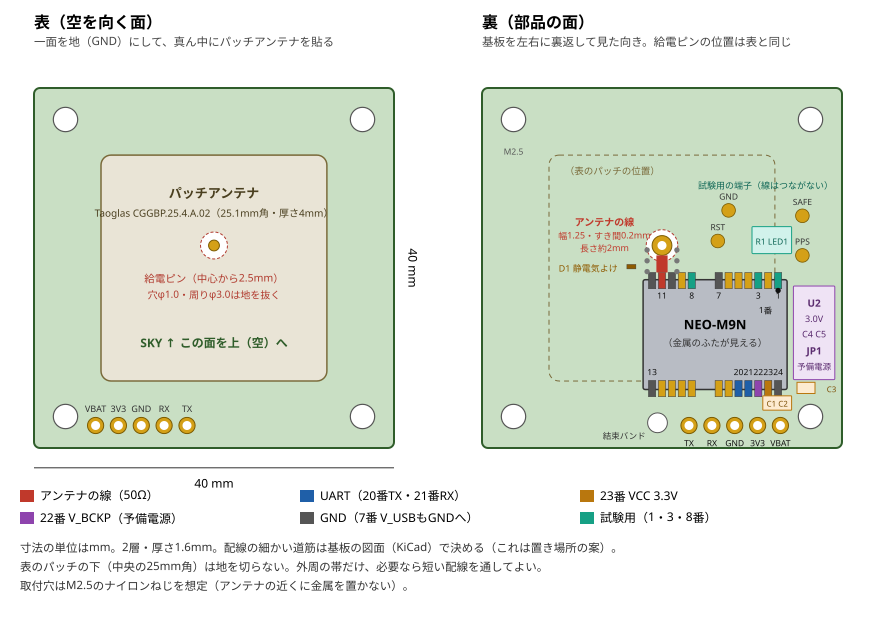

# カート用ロガー GNSSの載せ台基板（KT-3-2、2026-10-30 案）

> 状態：**回路と配置の案**（Claude作成）。Lintarohさんの確認の前。基板の図面（KiCad）と製造データ（ガーバー）はまだ無い。
> 決めたこと（2026-10-30 ユーザー）：GNSSは、SparkFunの基板（12,865円）をやめ、**u-blox NEO-M9N単体を自作の小さい基板に載せる**。
> 部品の値段と在庫は2026-10-30に各店のページで見た値（税込）。部品リストは`kart_parts_list_20261028.md`、日程は`task_kart_20261129_breakdown.md`。

## 0. 要点

- **40×40mmの2層基板**（厚さ1.6mm）。表（空を向く面）は一面を地にして、真ん中に**25mm角のパッチアンテナ**を貼る。裏にNEO-M9Nと小さな部品を載せる
- アンテナは基板に直接はんだ付けするので、**U.FL端子もケーブルも無い**（振動で抜ける心配が無い）
- **4種類の衛星（GPS・GLONASS・Galileo・BeiDou）＋みちびきで25Hz**（NEO-M9Nのデータシートで、どの組み合わせでも最大25Hz）
- Featherとは**線5本**（3V3・GND・TX・RX・VBAT）をじかにはんだ付けする。コネクタは使わない
- 電池の線（VBAT）から小さいレギュレーターで3.0Vを作り、NEO-M9Nの予備電源にする。
  電源スイッチを切っても衛星の情報を覚えているので、**次に入れたときは約2秒で位置が出る**（予備電源が無いと毎回24〜29秒）
- 部品代は**約4,850円**（DigiKey 4,246円＋秋月 600円）。基板の製作は**約1,500〜3,000円の見込み（未確認）**。合わせて**約6,400〜7,900円**で、SparkFunの基板＋アクティブアンテナ（約17,100円）より約1万円安い
- この基板は線5本で独立しているので、**試作1号でもそのまま使い回せる**（モジュールを外す必要が無い）
- 心配なのは、**地の広さが足りないこと**（アンテナのメーカーは70×70mm以上を推奨。1章）。11/20までに屋外で確かめ、だめならSparkFunの基板に切り替える（6章）

## 1. 要求と前提

| 項目 | 中身 |
|---|---|
| 速さ | 25Hz（UBX-NAV-PVTを毎回出す）。衛星は4種類＋みちびき |
| 電源 | Featherの3.3V。NEO-M9Nは2.7〜3.6V、最大100mA（衛星を探している瞬間）、4種類の衛星を追っているとき約36mA（データシートは1Hzでの値。25Hzでは増える見込み） |
| 予備電源 | Featherの電池（BAT端子）から。電源スイッチはFeatherのENを切る方式なので、スイッチを切っても電池はつながったまま（部品リスト3章） |
| 通信 | UART。初期値は38400bps・NMEA。ファームで115200bps以上・UBXだけに切り替える（KT-4-1）。NAV-PVTを25Hzで出すと約2.5kB/秒で、115200bpsの約2割 |
| 振動 | サスペンションの無いカートのハンドル。コネクタを使わず線をじかにはんだ付けし、結束バンドで基板に留める |
| アンテナの向き | パッチの面を空に向ける。上に金属を置かない（3Dプリントのふた越しなら問題ない）。画面・ESP32・SDからはできるだけ離す（デジタル回路の雑音が衛星の電波と同じ帯域に出るため） |
| 大きさ | 40×40mm。パッチ（Taoglas CGGBP.25.4.A.02）は**70×70mm以上の地**で設計されている。小さい地では受信の強さが下がり、合う周波数も少しずれる（どのくらいかは試すまで分からない）。**箱に入るなら大きいほどよい**（回路はそのままで外形だけ広げられる） |

ハンドルに付ける箱との関係（筐体KT-6で決める）：ロガーの箱をハンドルの面に沿って付けると、基板も同じ傾きになり、アンテナは運転者の胸の方を向く。
空の後ろ半分は体でさえぎられるので、**箱の中でこの基板をできるだけ水平（空向き）に近づけられるか**を筐体で検討してほしい。
ハンドルを切るとアンテナも傾くが、市販のカート用ロガー（ハンドルに付けてGPS内蔵）でも同じ条件で使われている。

## 2. 回路

### 2-1. つながり

```
  Feather ESP32-S3                載せ台基板
  3V3 ───────────────── 3V3 ──┬─ C3 10µF ──┬─ C1 1µF ─┬─ C2 0.1µF ── GND
                              └────────────┴──────────┴── U1 23番 VCC（C1・C2は23番のすぐ横）
  GND ───────────────── GND ──── U1 10・12・13・24番 GND、7番 V_USB もGNDへ
  RX  ───────────────── TX  ──── U1 20番 TXD（GNSS→Featherの向き）
  TX  ───────────────── RX  ──── U1 21番 RXD（Feather→GNSSの向き）
  BAT ───────────────── VBAT ─── C4 1µF ── U2 MCP1700（3.0V）── C5 1µF ── JP1 ── U1 22番 V_BCKP
                                                                          └（JP1の反対側＝3V3）

  ANT1 給電ピン ── アンテナの線（50Ω、約2mm）──┬── U1 11番 RF_IN
                                               └── D1 PESD0402-140 ── GND
  U1 3番 TIMEPULSE ── R1 1kΩ ── LED1 ── GND   ／ 試験用の端子 PPS
  U1 1番 SAFEBOOT_N、8番 RESET_N ── 試験用の端子（ふだんは何もつながない）
  U1 2番 D_SEL、4番 EXTINT、5・6番 USB、9番 VCC_RF、14番 LNA_EN、15〜17番、18・19番 I2C ── つながない
```

- NEO-M9Nは中にSAWフィルター・低雑音アンプ（LNA）・直流を止めるコンデンサー・50Ωの整合を持っている。
  **パッシブアンテナをRF_INにじかにつないでよい**（u-bloxの設計の手引き 4.5章）。VCC_RF（アクティブアンテナ用の電源）は使わない
- 入力のピンはモジュールの中で引き上げてあるので、使わないピンは何もつながなくてよい（データシート 5章）。
  D_SELを開けておくとUARTとI2Cが使える
- **V_USBは、USBを使わないならGNDにつなぐ**（手引き 4.2.3章）
- **予備電源（V_BCKP）**：何もつながないと電源を入れるたびに最初から衛星を探す（24〜29秒）。
  電池から3.0Vを作って入れておくと、電源を切っている間も時計と衛星の情報が残り、次は約2秒で位置が出る。
  NEO-M9Nがこのとき使う電流は約45µA、MCP1700の自己消費は約1.6µAで、2000mAhの電池なら何年分にもなる
- **JP1**（3つのパッドのはんだジャンパー）：ふだんは真ん中とMCP1700側をつなぐ。VBATの線をつながない場合は、真ん中と3V3側をつなぐ
  （予備電源を使わないときはV_BCKPをVCCにつなぐ、と手引きにある）
- **D1（静電気よけ）**：パッチアンテナは組み立て中に静電気をためていることがあり、はんだ付けの瞬間にRF_INへ放電して壊すことがある。
  手引きは、パッチアンテナを使うならRF_INの前に静電気よけを入れることを必須としている（4.9.3・4.9.4章）。容量の小さいRF用の0402サイズを選んだ
- **LED1**：衛星をつかむと1秒に1回点滅する（TIMEPULSEの初期設定）。屋外での確認用
- 電源の注意（データシート 4.1章）：VCCの立ち上がりは**1Vあたり20µs〜8ms**に収める必要がある。速すぎると壊れることがある。
  Featherの電源スイッチ（EN）で3.3V全体と一緒に立ち上がる形なので問題ない見込みだが、**電源を入れたまま線をつなぐ・外すのはしない**

### 2-2. NEO-M9Nのピン（全24本）

| 番号 | 名前 | つなぎ先 |
|---|---|---|
| 1 | SAFEBOOT_N | 試験用の端子SAFE（ファームの書き換えに失敗したときの復旧用。ふだんは開けておく） |
| 2 | D_SEL | 開けておく（UART＋I2C） |
| 3 | TIMEPULSE | R1→LED1→GND、試験用の端子PPS |
| 4 | EXTINT | 開けておく |
| 5 | USB_DM | 開けておく |
| 6 | USB_DP | 開けておく |
| 7 | V_USB | GND |
| 8 | RESET_N | 試験用の端子RST（GNDへ100ms以上落とすと最初からやり直し） |
| 9 | VCC_RF | 開けておく（アクティブアンテナ用） |
| 10 | GND | GND |
| 11 | RF_IN | アンテナの給電ピンへ（50Ωの線）、D1 |
| 12 | GND | GND |
| 13 | GND | GND |
| 14 | LNA_EN | 開けておく |
| 15〜17 | Reserved | 開けておく |
| 18 | SDA | 開けておく（I2Cを使うなら端子を足す） |
| 19 | SCL | 開けておく |
| 20 | TXD | 線の端子TX → FeatherのRX |
| 21 | RXD | 線の端子RX ← FeatherのTX |
| 22 | V_BCKP | JP1（ふだんはMCP1700の3.0V） |
| 23 | VCC | 3V3（C1・C2をすぐ横に） |
| 24 | GND | GND |

FeatherのどのピンをRX・TXに使うかは、ファームのピン割り当て（KT-4-1）で決める。

## 3. 部品表

| 記号 | 部品 | 品番 | 店（販売コード） | 数 | 価格（税込） | 在庫（10/30） |
|---|---|---|---|---|---|---|
| U1 | GNSSモジュール u-blox NEO-M9N | NEO-M9N-00B | [DigiKey](https://www.digikey.jp/ja/products/detail/u-blox/NEO-M9N-00B/12149174) | 1 | 2,800円 | **0個**。11/6に500個入る予定。入荷待ちで注文する |
| ANT1 | パッチアンテナ 25mm角（パッシブ、GPS・GLONASS・Galileo・BeiDou） | CGGBP.25.4.A.02 | [DigiKey](https://www.digikey.jp/ja/products/detail/taoglas-limited/CGGBP-25-4-A-02/4965527) | 1 | 1,209円 | 7,533個 |
| D1 | 静電気よけ（0402） | PESD0402-140 | [DigiKey](https://www.digikey.jp/ja/products/detail/littelfuse-inc/PESD0402-140/1968525) | 1 | 145円 | 513,470個 |
| U2 | レギュレーター 3.0V（自己消費1.6µA、SOT-23） | MCP1700T-3002E/TT | [DigiKey](https://www.digikey.jp/ja/products/detail/microchip-technology/MCP1700T-3002E-TT/651114) | 1 | 92円 | 173,309個 |
| C1・C4・C5 | セラミックコンデンサー 1µF 25V（1608） | GRM188B31E105KA75 | [秋月（130397）](https://akizukidenshi.com/catalog/g/g130397/) | 40個入×1 | 100円 | 在庫あり |
| C2 | セラミックコンデンサー 0.1µF 100V X7R（1608） | GRM188R72A104KA35D | [秋月（114559）](https://akizukidenshi.com/catalog/g/g114559/) | 20個入×1 | 150円 | 在庫あり |
| C3 | セラミックコンデンサー 10µF 16V X5R（2012） | CL21A106KOQNNNE | [秋月（107542）](https://akizukidenshi.com/catalog/g/g107542/) | 20個入×1 | 100円 | 在庫あり |
| R1 | チップ抵抗 1kΩ（1608） | RK73B1JTTD102J | [秋月（130351）](https://akizukidenshi.com/catalog/g/g130351/) | 100個入×1 | 150円 | 在庫あり |
| LED1 | 黄緑のチップLED（1608） | SML-E12P8WT86 | [秋月（111878）](https://akizukidenshi.com/catalog/g/g111878/) | 10個入×1 | 100円 | 在庫あり |
| JP1 | はんだジャンパー | （基板の銅箔） | ― | ― | ― | ― |
| PCB | 基板 40×40mm 2層 1.6mm | ― | JLCPCBなど | 5枚〜 | 約1,500〜3,000円（未確認） | ― |
| ― | ナイロンねじ M2.5 | ― | 近所 | 4 | 数百円 | ― |

- 合計：DigiKey 4,246円、秋月 600円、基板 約1,500〜3,000円 → **約6,400〜7,900円**
- 小さなコンデンサーは、DigiKeyではSamsung・Murataの定番品が軒並み在庫切れだったので秋月にした（秋月はほかの部品も頼むため送料は増えない）
- 基板は電子部品の載っていない板だけを作ってもらう。電子部品はすべてDigiKey・秋月から買うので、「基板は正規の店で」の方針に沿う
- 予備に、NEO-M9N以外の小さな部品は2〜3個ずつ多めにある（袋売りのため）

## 4. 配置



| 項目 | 中身 |
|---|---|
| 外形 | 40×40mm、角は丸める。取付穴4つ（φ2.7、M2.5のナイロンねじ）を角から3.5mm |
| 層 | 2層、FR-4、厚さ1.6mm、銅1oz。表面処理は鉛フリーのHASL（モジュールを平らに載せたいならENIG） |
| 表 | 一面を地にする。パッチを中心に置く（Taoglasの手引き 4.4章）。**パッチの下（中央の25mm角）は地を切らない**。外周の帯だけ、必要なら短い配線を通してよい |
| パッチの給電ピン | 中心から2.5mm。穴φ1.0（スルーホール）、表のパッドφ1.2、裏のパッドφ2.2。地を抜く範囲は表φ3.0、裏φ3.5（Taoglasの手引き 4.2・4.3章）。まわりに地のビアを並べる |
| モジュール | 裏。長い辺を横にし、11番（RF_IN）を給電ピンの真下に向ける。給電ピンの穴はモジュールにかからない位置 |
| アンテナの線 | 裏で、給電ピンから11番まで**約2mm**。地つきのコプレーナ線（両側と表の地を基準にする）。**幅1.25mm、両側のすき間0.2mm**で50Ω（厚さ1.6mm、比誘電率4.5で計算）。線の両側に地のビアを並べる。枝分かれ（スタブ）を作らない（手引き 4.8.4章）。2mmは波長の1/50ほどなので、幅が多少ずれても影響は小さい |
| D1 | アンテナの線の給電ピン寄りに、線とGNDの間 |
| VCC | 23番へは幅0.4mm以上。C1（1µF）とC2（0.1µF）を23番のすぐ横に（手引き 4.8.4.2・4.9.1章） |
| 地 | 裏も空いているところは地で埋め、表とビアで細かくつなぐ（約3mmおき）。モジュールの下も地にし、配線を通さない |
| 線の端子 | 下の辺に5つ、2.54mmおき（穴φ1.0、パッドφ1.8）。裏から見て左から TX・RX・GND・3V3・VBAT。モジュールの20〜24番の真下に来るので、線が交差しない。横に結束バンドの穴（φ2.2） |
| 予備電源 | U2・C4・C5・JP1はモジュールの右。22番からの線は、20・21番の線をまたぐ必要があれば外周の帯で表へ短く逃がす |
| LED・試験用の端子 | モジュールの上側（1・3・8番の近く）。試験用の端子はφ1.5の丸いパッド |
| モジュールの足跡 | u-bloxの推奨（パッド0.8mm幅、1.1mmおき。手引き 4.8.3章）。**手はんだのため、パッドを外へ長めに出す**。KiCadの標準ライブラリのNEO用の足跡（`RF_GPS:ublox_NEO`、要確認）をもとに伸ばす |
| 文字 | 表に「SKY ↑」、裏に線の端子の名前・モジュールの1番の印・JP1の向き |

厚さは、基板1.6mm＋パッチ4mm＋モジュール2.4mm＋線で、約9mm。

## 5. 組み立て（はんだ付け）

1. 裏の小さな部品を先に付ける：C1〜C5・R1・LED1・U2・D1（D1は0402で小さい。ピンセットで）
2. NEO-M9Nを付ける。フラックスを塗り、対角の2本で位置を決めてから、残りのパッドを1本ずつ（パッドが外へ出ているので、こて先を当てられる）
3. ショートの確認：テスターで3V3–GND、VBAT–GNDが短絡していないこと
4. JP1をはんだでつなぐ（真ん中とMCP1700側）
5. **パッチアンテナは最後**。付ける前に体の静電気を逃がす（金属に触る）。両面テープの紙をはがし、給電ピンを表から穴に差し、裏ではんだ付けする
6. 線5本をはんだ付けし、結束バンドで基板の穴に留める。TX・RXはGNDの線とより合わせ、20cm以内にする

## 6. 確かめ方（KT-3-2-6、11/20まで）

1. 室内で電源を入れ、3V3の電流が100mA以下であること、UARTから38400bpsでNMEAの文が出ることを見る
2. Featherに中継のプログラムを入れ（Claudeが用意）、PCのu-blox u-centerで見る：
   - 屋外の開けた場所で、位置が出るまでの時間（最初は30秒程度）
   - 見えている衛星の数（GPS・GLONASS・Galileo・BeiDou・みちびき）
   - 受信の強さ（C/N0）：強い衛星で40dB-Hz以上が出ていれば十分。35dB-Hzに届かないなら、地の広さかアンテナの合い方に問題がある
3. 25Hz・115200bps・UBX-NAV-PVTだけに切り替え、1秒に25個出ることを見る
4. 電源を切って数分後に入れ直し、数秒で位置が出ること（予備電源が効いていること）を見る
5. だめなら**SparkFun NEO-M9N（15712）＋Taoglas AGGBP.25A.07.0060A（合計約17,100円）**を注文する。10/28時点でどちらもDigiKeyに在庫があり、3〜4日で届く。11/20に頼めば11/23からの事前確認（KT-8）に間に合う

## 7. Lintarohさんに見てほしいところ

1. アンテナの線（2層・1.6mmで幅1.25mm・すき間0.2mmのコプレーナ線、長さ約2mm）と、給電ピンの穴のまわりの作り方
2. 地が40×40mm（推奨の70×70mmより小さい）でどのくらい受信が落ちそうか。外形を広げるべきか、小さい地向けのアンテナにすべきか
3. D1（PESD0402-140）を1.5GHz帯のアンテナの線に入れてよいか（容量は未確認）
4. 予備電源：電池（3.0〜4.2V）→MCP1700（3.0V）→V_BCKP。Featherの電源を切っている間にUARTの線から回り込む心配が無いか（手引きは、VCCを切っている間は入出力を浮かせることを求めている）
5. VCCの立ち上がりの条件（1Vあたり20µs〜8ms）を、FeatherのENスイッチで3.3Vを入れる形で満たせるか
6. 手はんだのためにパッドをどこまで外へ伸ばすか
7. 画面・SD・ESP32-S3の雑音がアンテナに入らない置き方（箱の中の位置）
8. UARTでよいか（FeatherのI2C（STEMMA QT）につなぐ手もある）

## 8. 日程

| いつ | やること | 担当 |
|---|---|---|
| 10/30 | 回路と配置の案（この資料） | Claude（済み） |
| 〜11/5 | 部品の注文（DigiKey・秋月の注文に入れる。NEO-M9Nは入荷待ち） | ユーザー（KT-2-2） |
| 〜11/8 | 基板の図面（KiCad）と製造データ（ガーバー） | 未定（ClaudeならこのPCにKiCadを入れる必要あり。11/8まではLintarohさんはSUGO優先） |
| 11/9〜 | 確認（7章） | Lintarohさん |
| 11/10ごろ | 基板を頼む（製作2〜3日＋配送の見込み） | ユーザー |
| 11/17ごろ | 基板が届く → はんだ付け（5章） | 未定（KT-7と同じ人） |
| 〜11/20 | 屋外で確かめる（6章）。だめならSparkFunの基板を頼む | ユーザー・Claude |

GNSSが手元に来るのは11/17以降になるので、それまでのファーム作り（KT-4-1）は、録った走行データや手持ちの機材でUBXの読み取りを先に作る。

## 出典（2026-10-30に見たもの）

- u-blox：[NEO-M9N-00B データシート（UBX-19014285 R08）](https://content.u-blox.com/sites/default/files/NEO-M9N-00B_DataSheet_UBX-19014285.pdf)（ピン・電圧・電流・25Hz・寸法）、
  [NEO-M9N 設計の手引き（UBX-19014286 R10）](https://content.u-blox.com/sites/default/files/NEO-M9N_Integrationmanual_UBX-19014286.pdf)（最小の回路・パッシブアンテナ・静電気・足跡・アンテナの線）
- Taoglas：[CGGBP.25.4.A.02 データシート（SPE-14-8-071-G）](https://www.taoglas.com/datasheets/CGGBP.25.4.A.02.pdf)（寸法・給電ピン・足跡・地を抜く範囲・70×70mmの地）
- DigiKey・秋月：3章の表のリンク先
- アンテナの線の幅：地つきコプレーナ線の式で計算（厚さ1.6mm、比誘電率4.5、すき間0.2mmで幅1.25mmが50Ω）
